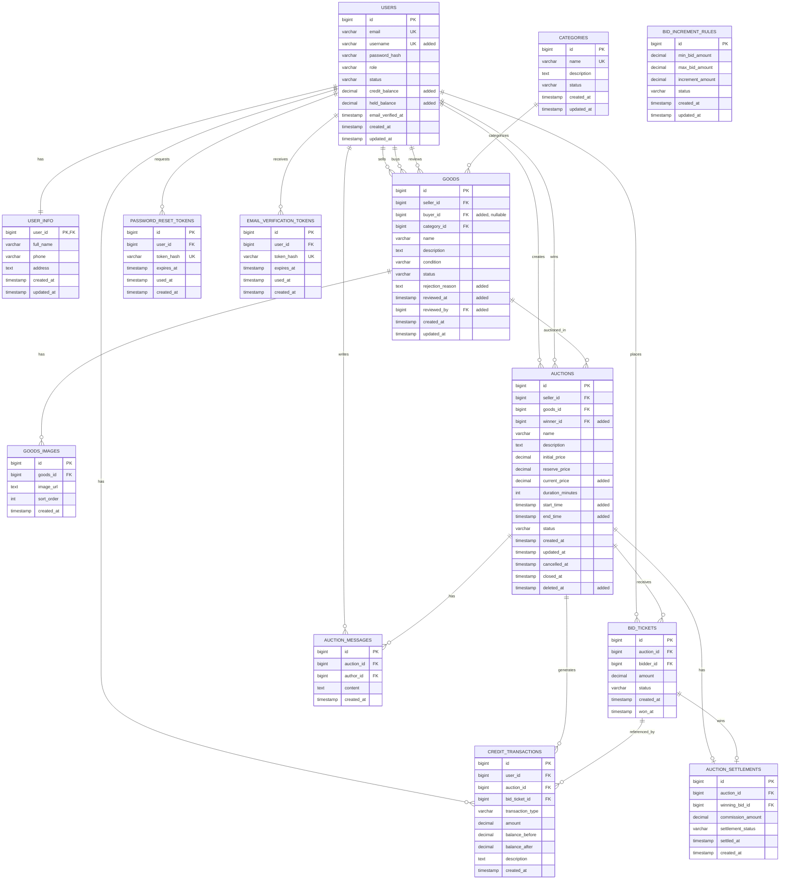

//Edited copy of docs/ERD.md. docs/ERD.md is kept unchanged as the original.
//This file is the one used to build the database (be/prisma/schema.prisma).
//Every entity/column from the original is preserved. Additions are listed in
//"Changes vs ERD.md" below and marked with "-- added" comments in the diagram.

## Changes vs ERD.md

| Change | Why (feature) |
|---|---|
| USERS: added `username` (UK) | cust-001 login by "username/email" |
| USERS: added `credit_balance`, `held_balance` | cust-005 credit account; bid-001 check bids against available credit; sell-002 release held credit |
| AUCTIONS: added `start_time`, `end_time` | sell-001 start/end time, guest-002 countdown (`duration_minutes` kept, = end - start) |
| ~~AUCTIONS: added `min_increment`~~ | Removed 2026-10-20 (migration `20261020040000_drop_min_increment`): bids step by BID_INCREMENT_RULES only. See docs/changes/drop-min-increment.md |
| AUCTIONS: added `current_price`, `winner_id` | cust-006/cust-007 current highest bid and outcome without re-aggregation |
| new AUCTION_MESSAGES | bid-002 post a message on an auction (public thread) |
| new PASSWORD_RESET_TOKENS | cust-004 forget password (single-use token) |
| new EMAIL_VERIFICATION_TOKENS | guest-002 register: confirmation email |
| GOODS: added `buyer_id` (FK USERS, nullable) | gds-003 goods remember who bought them so the buyer can re-auction them (migration `20261021090000_goods_buyer`, backfilled from the last auction that ended with a winner) |

| GOODS: added `rejection_reason`, `reviewed_at`, `reviewed_by` (FK USERS); status `pending`/`rejected` | stf-005 staff approval of new goods (see docs/goods-approval.md) |

| AUCTIONS: added `deleted_at` | stf-006 staff soft delete (hidden from customers; see docs/auction-cancel.md) |

Goods ownership (gds-003): the current owner is `buyer_id` when set, otherwise `seller_id`. When an auction ends
with a winner, settlement sets `goods.seller_id` = that auction's seller and `goods.buyer_id` = the winner, in the
same transaction. On a first sale the seller is unchanged; on a resale the previous buyer (the reseller) becomes the
seller. No winner (no bids, reserve not met) or a cancel leaves both columns unchanged. Only the owner can auction,
edit or delete the goods; the former seller sees them as sold.

Status values used:
- USERS.status: `active`, `pending`, `disabled`
- AUCTIONS.status: `upcoming`, `active`, `ended`, `cancelled` (upcoming/active/ended derived from time when not cancelled)
- BID_TICKETS.status: `active`, `outbid`, `won`, `lost`, `cancelled`
- CREDIT_TRANSACTIONS.transaction_type: `topup`, `withdraw`, `hold`, `release`, `payment`, `payout`

